# Práctica del Parcial 3: bases de datos distribuidas en GNS3

Topología en **GNS3** con 4 bases de datos en sistemas operativos distintos, routers Cisco con **OSPF**
y un nodo **Usuario** que inserta registros y los replica en anillo entre las 4 bases.

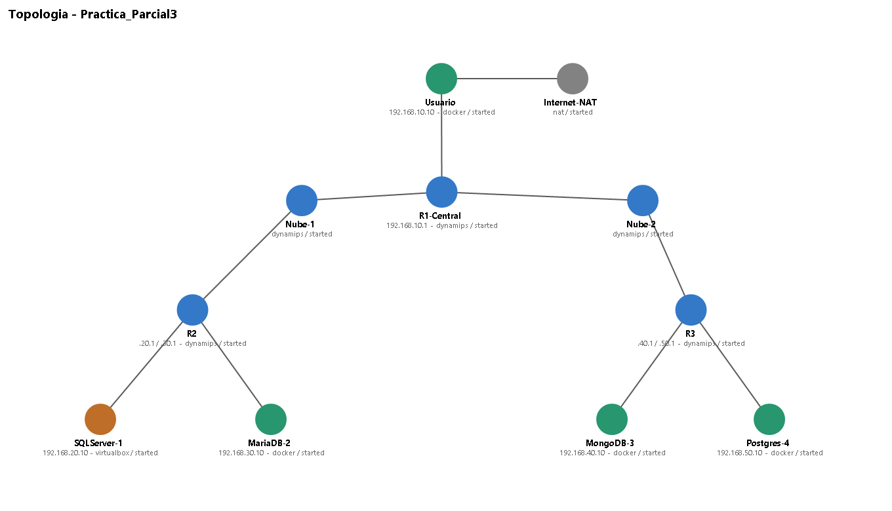

| # | Base de datos | Sistema | IP : puerto | Router |
|---|---|---|---|---|
| 1 | SQL Server 2025 Express | Windows Server 2022 (VM VirtualBox) | 192.168.20.10 : 1433 | R2 (vía Nube-1) |
| 2 | MariaDB 11.4 | Linux (Docker) | 192.168.30.10 : 3306 | R2 (vía Nube-1) |
| 3 | MongoDB 7 | Linux (Docker) | 192.168.40.10 : 27017 | R3 (vía Nube-2) |
| 4 | PostgreSQL 16 | Linux (Docker) | 192.168.50.10 : 5432 | R3 (vía Nube-2) |
| – | Usuario (Python 3.12) | Linux (Docker) | 192.168.10.10 | R1-Central |

- **Routers:** Cisco c7200 (R1-Central, Nube-1, Nube-2, R2, R3) unidos por enlaces seriales /30 (10.0.1.0 a 10.0.4.0), todos en **OSPF área 0**.
- **Replicación:** `codigo/practica.py` copia los registros en anillo **1 → 2 → 3 → 4 → 1**. Cada registro lleva un UUID, así que nunca se duplica.

> Las contraseñas que aparecen en este repositorio (`Practica123`, `Practica123!`) son **solo de laboratorio** y únicamente funcionan dentro de la red de GNS3.

---

## Contenido del repositorio

```
├── gns3/Practica_Parcial3.gns3project   Proyecto de GNS3 (sin la imagen de Cisco)
├── scripts/instalar.ps1                 Importa VM + proyecto y conecta SQL Server a R2
├── scripts/verificar.ps1                Corre las 9 pruebas y genera capturas PNG
├── codigo/practica.py                   Insertar, replicar y mostrar registros (4 bases)
├── codigo/probar_bases.py               Prueba de login a las 4 bases
├── codigo/install_sql.ps1               Cómo se instaló y configuró SQL Server en la VM
├── capturas/                            Resultados de las pruebas (9 de 9)
└── docs/GUIA.html                       Guía detallada con capturas y problemas comunes
```

### Archivos que van aparte

| Archivo | Por qué | Dónde conseguirlo |
|---|---|---|
| `Win-SQL.ova` (7.3 GB) en 4 pedazos: `Win-SQL.ova.001` … `.004` y `Win-SQL.ova.sha256` | GitHub no acepta archivos de más de 100 MB en el repositorio | **[Release v1.0](../../releases/tag/v1.0)** de este repositorio (sección *Assets*) |
| `c7200-adventerprisek9-mz.124-24.T5.image` | Imagen de Cisco IOS con licencia; no se puede publicar | Pídela a tu profesor o compañeros |

Pon todos esos archivos en una carpeta `descargas/` dentro del repositorio. `instalar.ps1` los busca ahí,
**une los 4 pedazos solo** y comprueba con la huella SHA-256 que el `.ova` quedó idéntico.
(También puedes unirlos a mano con doble clic en `unir.cmd`, que viene en el Release.)

---

## Requisitos

- Windows 10/11 con **16 GB de RAM**, unos **30 GB libres** y virtualización (VT-x/AMD-V) activada en la BIOS.
- **VirtualBox 7.x**.
- **GNS3 2.2.61** y la **GNS3 VM 2.2.61 para VirtualBox** ([releases](https://github.com/GNS3/gns3-gui/releases)).
  En GNS3: *Edit → Preferences → GNS3 VM* → *Enable*, motor VirtualBox, 4 vCPU y 6144 MB. Debe salir en verde.

> **Hipervisor de Windows:** si Hyper-V o la "Seguridad basada en virtualización" están activos, VirtualBox va lento o se cierra.
> Para apagarlos, abre una terminal **como administrador**, ejecuta lo siguiente y **reinicia**:
> ```
> bcdedit /set hypervisorlaunchtype off
> reg add "HKLM\SYSTEM\CurrentControlSet\Control\DeviceGuard" /v EnableVirtualizationBasedSecurity /t REG_DWORD /d 0 /f
> ```
> Además deja **Integridad de memoria** en *Desactivado* (Seguridad de Windows → Seguridad del dispositivo).

## Instalación

1. Clona o descarga el repositorio. Crea la carpeta `descargas/` y pon ahí los 4 pedazos de la VM con su `.sha256` (del Release) y la imagen c7200.
   Con GitHub CLI se descargan así:
   ```powershell
   gh release download v1.0 --repo hernandezalvirdemariaguadalupe-cyber/practica-parcial3-gns3 --dir descargas
   ```
2. Abre **GNS3** y espera a que la GNS3 VM salga en verde.
3. En la carpeta del repositorio ejecuta:
   ```powershell
   powershell -ExecutionPolicy Bypass -File .\scripts\instalar.ps1
   ```
4. En GNS3: **File → Open project → Practica_Parcial3**, presiona **Start** y espera unos 3 minutos.
   La primera vez, la GNS3 VM descarga de Docker Hub las imágenes de MariaDB, MongoDB, PostgreSQL y Python.

## Verificación

```powershell
powershell -ExecutionPolicy Bypass -File .\scripts\verificar.ps1
```

| # | Prueba | Qué demuestra |
|---|---|---|
| 01 | Nodos encendidos | Todos los nodos están corriendo |
| 02 | OSPF en R1-Central | 2 vecinos en FULL y las 4 redes de bases aprendidas |
| 03 | OSPF en Nube-1, Nube-2, R2 y R3 | Todas las adyacencias OSPF |
| 04 | Ping a las 4 bases | El Usuario alcanza cada servidor |
| 05 | Traceroute | Camino R1-Central → Nube-1 → R2 y R1-Central → Nube-2 → R3 |
| 06 | Login a las 4 bases | Cada motor acepta la conexión |
| 07 | Insertar | 1 registro en cada base |
| 08 | Replicación en anillo | Cada base queda con los 4 registros |
| 09 | Mostrar | Las 4 bases tienen los mismos registros |

Con `-SinReplicacion` no se tocan los datos. Las capturas se guardan en `scripts/capturas/`.

### Resultados (máquina original)

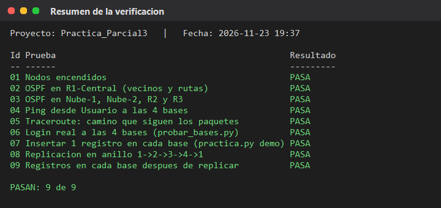

<details>
<summary>Ver todas las capturas</summary>

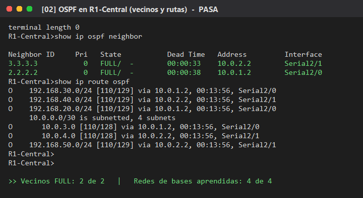
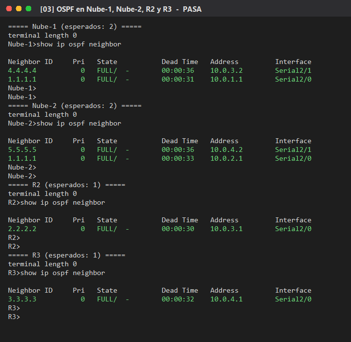
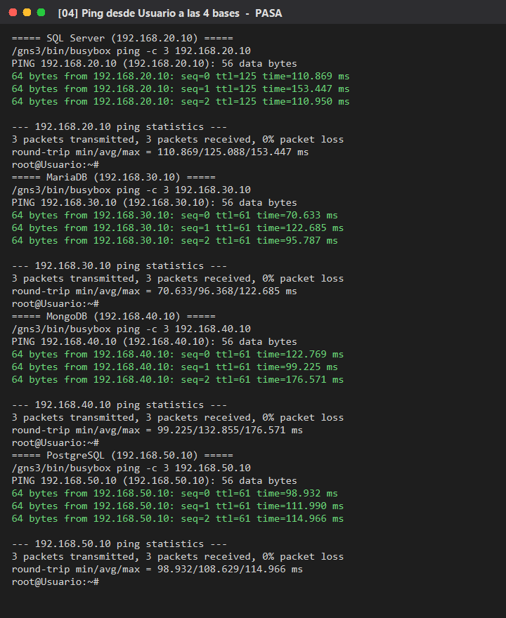
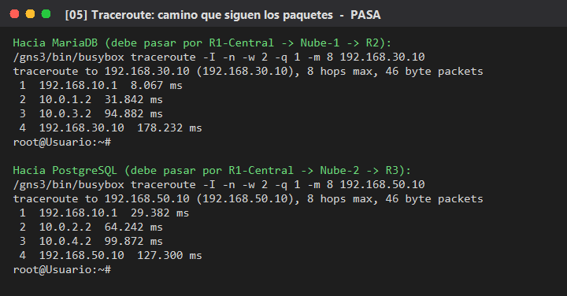
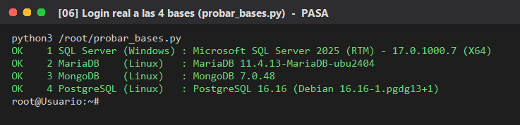
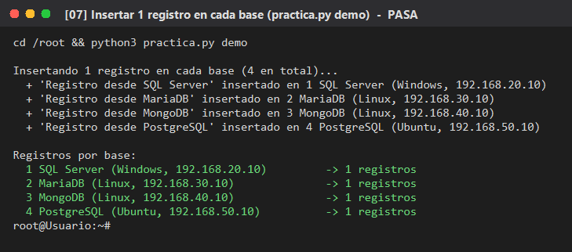
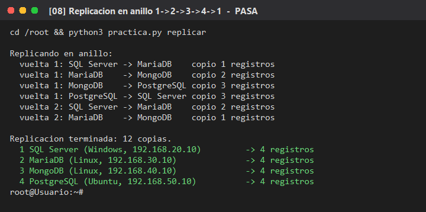
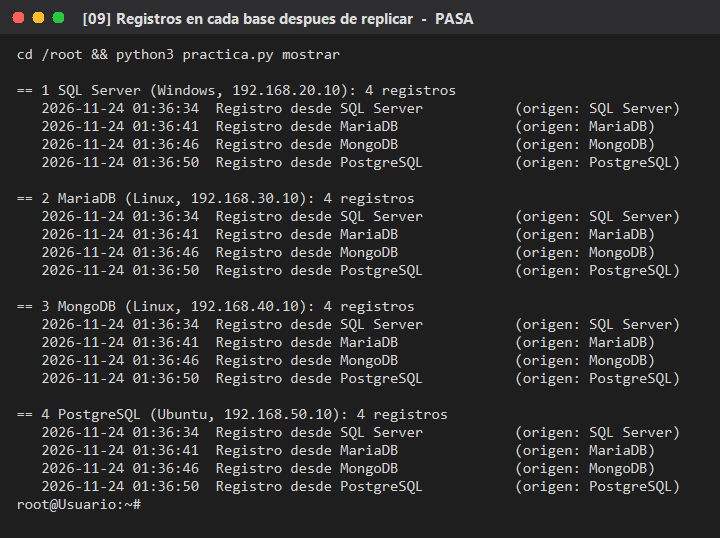
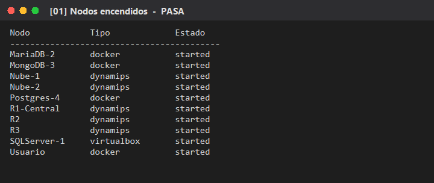

</details>

## Uso de la práctica (consola del Usuario en GNS3)

```bash
cd /root
python3 practica.py            # menú interactivo
python3 practica.py demo       # 1 registro en cada base
python3 practica.py replicar   # replica en anillo 1->2->3->4->1
python3 practica.py mostrar    # registros de cada base
python3 practica.py limpiar    # vacía las 4 bases
```

## Notas técnicas

- **MariaDB:** al arrancar borra `tc.log`. GNS3 detiene los contenedores de golpe y ese archivo queda dañado (*"Bad magic header in tc log"*), lo que impedía reiniciar.
- **PostgreSQL:** usa `PGDATA=/var/lib/postgresql/data/pgdata` (GNS3 deja un `.gns3_perms` en el volumen) y recrea al arrancar las carpetas vacías que los snapshots de GNS3 no guardan.
- **SQL Server:** GNS3 no exporta proyectos con nodos de VirtualBox. Por eso el proyecto se exporta sin SQLServer-1 y `instalar.ps1` lo agrega conectado a R2 FastEthernet0/0.
- **Traceroute:** Windows Server no responde al traceroute. La prueba 05 usa MariaDB para el camino de Nube-1, y SQL Server se comprueba con ping y login.
